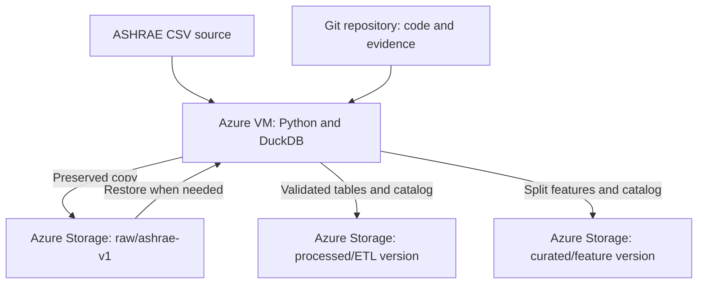

## Project and hypothesis

**Project:** One-hour-ahead building electricity consumption prediction.

**Team:** Saif al deen Judeh (60306539) and Adam Nashbat (60304819).

**Target:** The electricity meter reading at a building's next reported hourly timestamp,
standardized to kWh. **Baseline:** The same building's reading at the same hour one week
earlier (168 hours before the target). **Hypothesis:** A gradient-boosting model using
recent electricity readings, building characteristics, calendar information and recently
observed outdoor temperature will achieve at least 10% lower MAE than the weekly baseline
on chronologically later observations.

This Phase 1 submission implements the data foundation and initial features, not model
training or a test of the performance hypothesis. Temperature remains planned but is
not yet included: weather/meter timestamp alignment and forecast-time availability
need validation. The initial feature subset does not establish the full hypothesis.

Forecast origin is target timestamp minus one hour. The offline assumption is that a
reading is complete and available at its reported timestamp. Actual interval-label and
delivery-latency conventions must be confirmed before operational use. Evaluation is
planned as rolling one-hour-ahead prediction, allowing earlier observed validation/test
readings to become history for later forecasts without fitting on those labels.

## Dataset and architecture

Source: [ASHRAE Great Energy Predictor III](https://www.kaggle.com/competitions/ashrae-energy-prediction/data).
The dataset is different from the Titanic and Amazon lab datasets. The selected source
snapshot is `ashrae-v1`; CSV batch ingestion is run manually when a new version is approved.
Refreshes must use a new version and manifest; preserved versions are never overwritten.

The six extracted files total **2,610,923,746 bytes** (about 2.43 GiB). Excluding the
submission template, source data totals **2,163,361,235 bytes**, exceeding the approximately
1 GB requirement. All six files were ingested and fully profiled; no profiling sample
was used. The smaller supervised subset must not be described as the entire source.

| Raw file | Role | Rows |
|---|---|---:|
| train.csv | Observed meter readings across meter types | 20,216,100 |
| test.csv | Unlabeled competition prediction inputs | 41,697,600 |
| sample_submission.csv | Submission-format template, not observed labels | 41,697,600 |
| building_metadata.csv | Building/site/use/area and optional year/floor metadata | 1,449 |
| weather_train.csv | Training weather by site and reported timestamp | 139,773 |
| weather_test.csv | Competition test-period weather | 277,243 |

The project's validation and test partitions come from labeled `train.csv`, not from the
unlabeled competition `test.csv`. Electricity is meter code 0. Site 0 electricity is in
kBTU, confirmed by the [organizer's unit correction](https://www.kaggle.com/c/ashrae-energy-prediction/discussion/119261).
Only these readings are multiplied by 0.29307107; original readings/units remain available.

Azure resources: Ubuntu VM `vm-titanic-lab2`, 4 vCPUs and 16 GiB RAM, and storage account
`amazonlake60306539` (ADLS Gen2 enabled), in Qatar Central. The private container is
`electricity-project`. Azure CLI Blob APIs use the current Entra login. No managed feature
store, Purview service, new compute cluster or additional Azure service is created.



Processing reads verified local copies on the VM. Cloud publication verifies downloaded
bytes against SHA-256 and uploads the completion manifest last. Raw, processed and
curated versions have been published and verified, including safe reruns.

Storage layout:

- `raw/ashrae-v1/`: six original CSVs and source manifest.
- `processed/etl-v1-c4c56f89d676b969/`: electricity, metadata and weather Parquet; catalog and output manifest.
- `curated/features-v1-4416c69c061b464e/`: training/validation/test features; feature catalog and manifest.
- Local mirrors: `~/electricity-data/incoming/ashrae-v1`, `~/electricity-data/processed`, `~/electricity-data/features`.

Catalog JSON files record columns, types, keys and policies. Hash manifests connect
raw identity to processed outputs and feature outputs. They are an equivalent metadata
catalog/lineage structure; no Unity Catalog registration is claimed. Detailed policies:
[ETL rules](docs/etl_rules.md), [processed publication](docs/processed_publication.md),
[features](docs/features_v1.md) and [pipeline operation](docs/pipeline_operation.md).

## Run the pipeline

Prerequisites: Linux VM, Python 3.12, Git, Azure CLI with an active login to the course
subscription, and blob read/write permissions on the existing private container. Use
the submitted code checkout, preserved manifests and pinned configuration together.
Do not edit old code/config and expect an old version's identity checks to pass.

Clone the submitted repository to `~/electricity-project`. For a fresh environment:

```bash
cd ~/electricity-project
python3 -m venv .venv
.venv/bin/python -m pip install -r requirements.txt
az account show --query '{Subscription:name,State:state}' --output table
```

If Azure authentication has expired, sign in with your own authorized account and
select the course subscription. Access is controlled by Azure permissions, not by
making the container public. Dataset terms remain those of the source competition.

The six CSVs must exist at `~/electricity-data/incoming/ashrae-v1`. The team transferred
the original download there from Windows. An authorized reviewer can instead restore
the exact preserved version from Azure (downloads only files not already present):

```bash
mkdir -p ~/electricity-data/incoming/ashrae-v1
for name in building_metadata.csv sample_submission.csv test.csv train.csv weather_test.csv weather_train.csv
do
  target="$HOME/electricity-data/incoming/ashrae-v1/$name"
  if [ ! -e "$target" ]; then
    az storage blob download --account-name amazonlake60306539 \
      --container-name electricity-project --name "raw/ashrae-v1/$name" \
      --file "$target" --auth-mode login --no-progress
  fi
done
```

The pipeline verifies all source sizes/hashes before using them. Run:

```bash
cd ~/electricity-project
.venv/bin/python scripts/run_pipeline.py
```

The default run executes five test suites and eight data stages, with a console log
and linked evidence for each stage. A failure stops subsequent stages. ETL and feature
directories are obtained from the just-completed stage reports, not guessed from a
directory listing. Full profiling is repeated; data publication reuses verified assets.

After this exact code passes, demonstrate the full data-stage rerun without repeating
the unchanged synthetic test suites:

```bash
.venv/bin/python scripts/run_pipeline.py --skip-tests
```

Both commands were executed successfully on the Azure VM: the full run passed all
13 stages, and the data-stage rerun passed all 8 stages. The five synthetic test suites
passed 40 checks in total. The runner tests intentionally print failed child stages;
the suite passes only when those expected failures are correctly detected. Individual
commands remain in the linked technical documents. Dependencies: `duckdb==1.4.3` plus
Python standard library.

## Results and features

Verified results from the team's Azure VM:

- Raw ingestion: uploaded 7 objects; rerun uploaded 0 and skipped 7.
- Full profiling: all six files scanned; no duplicate natural keys. Metadata covered all training rows.
- ETL: 20,216,100 input training rows = 12,060,910 accepted electricity rows + 8,155,190 excluded non-electricity rows + 0 rejected rows.
- Metadata: 1,449 accepted; weather: 139,773 accepted. Missing optional values remain NULL.
- ETL tests: 9 passed, including controlled invalid input blocking publication and safe reruns.
- Processed Azure publication: uploaded 5; rerun uploaded 0 and skipped 5, with downloaded SHA-256 verification.
- Feature tests: 9 passed, including exact offsets, gaps, split boundaries, no current/future label influence on predictors and safe reruns.
- Feature build and rerun passed, preserving all electricity targets.
- Feature Azure publication: uploaded 5; rerun uploaded 0 and skipped 5, with downloaded SHA-256 verification.
- Full pipeline: 13 stages passed. Data-stage rerun: 8 stages passed. All 40 synthetic checks passed.

| Target partition | Period in 2016 | Rows | Weekly-baseline eligible |
|---|---|---:|---:|
| Training | January–August | 7,992,493 | 7,706,058 |
| Validation | September–October | 2,045,185 | 2,038,958 |
| Test | November–December | 2,023,232 | 1,989,186 |

Initial predictors are building/site IDs (categorical), use, area, hour, weekday, month,
weekend flag, exact 1/24/168-hour historical readings, missing-history indicators and
previous-hour-zero flag. Predictor allowlisting excludes target, partition, evaluation
mask and audit timestamps. Imputation/encoding/scaling have not been fitted. Any later
learned transforms must fit on training data only. Weekly-baseline MAE comparison must
use the same eligible rows for both models, with excluded counts reported separately.

Full training EDA is summarized in [EDA findings](docs/eda_findings_v1.md). Site 0 accounts
for about 73% of training zeros. There are 206,659 missing hours inside observed spans,
and one building is zero for all 5,856 training hours. These findings justify exact-time
joins and missing indicators and leave unresolved sensor/operational-quality risks.
Zeros and high values are not automatically deleted. Training target correlations with
1/24/168-hour lags are approximately 0.986/0.969/0.966. They are descriptive associations,
potentially influenced by building scale and zero runs, not forecast accuracy.

The combined pipeline also reproduces monthly/site distributions, quantiles, largest
readings, gaps, zero runs and building-area correlations in `evidence/eda_summary_*.json`.
Across 1,410 training-period buildings, the correlation between average electricity
and floor area was 0.593; the correlation between log1p average electricity and log area
was 0.767. These descriptive associations support exploring building area as a feature
but do not establish causation or predictive improvement. Pooled monthly changes must
be interpreted with reporting coverage and zero frequency. The 10% MAE hypothesis
has not yet been tested.

Supporting evidence:

- [source_manifest_v1.json](evidence/source_manifest_v1.json) and [raw_v1_etags.json](evidence/raw_v1_etags.json).
- [profile_20261113T140927Z-bfc742ba.json](evidence/profile_20261113T140927Z-bfc742ba.json).
- [etl_20261113T143147Z-607da4c3.json](evidence/etl_20261113T143147Z-607da4c3.json) and [etl_20261113T143316Z-2c9048b7.json](evidence/etl_20261113T143316Z-2c9048b7.json).
- [publish_processed_20261113T145235Z-211502ea.json](evidence/publish_processed_20261113T145235Z-211502ea.json) and [publish_processed_20261113T145417Z-814dd8ce.json](evidence/publish_processed_20261113T145417Z-814dd8ce.json).
- [time_quality_20261113T150254Z-67d35722.json](evidence/time_quality_20261113T150254Z-67d35722.json) and [lag_coverage_20261113T150505Z-d605a606.json](evidence/lag_coverage_20261113T150505Z-d605a606.json).
- [features_20261113T151352Z-949f841d.json](evidence/features_20261113T151352Z-949f841d.json) and [features_20261113T151534Z-c8eb3fa1.json](evidence/features_20261113T151534Z-c8eb3fa1.json).
- [feature_test_20261113T151649Z-68ea20c1.json](evidence/feature_test_20261113T151649Z-68ea20c1.json).

- [Full pipeline: 13 stages passed](evidence/pipeline_20261113T152643Z-170f7d7e.json).
- [Complete data-stage rerun: 8 stages passed](evidence/pipeline_20261113T153130Z-77298e09.json).
- [First feature publication](evidence/publish_features_20261113T152936Z-0a742360.json) and [verified publication rerun](evidence/publish_features_20261113T153419Z-c73f97b5.json).
- [Reproducible training EDA](evidence/eda_summary_20261113T152931Z-f4314577.json) and [EDA rerun](evidence/eda_summary_20261113T153413Z-d1018501.json).

Implementation checkpoint `ffe9eb0` records the completed pipeline and its Azure
verification evidence. Documentation is finalized in a subsequent commit. For course
submission, provide this repository's URL and the exact final commit or release in
D2L, and grant the instructor access. The applicable due date is shown in D2L.

## Resource use and contributions

| Observed job | Duration | Peak process RSS | Output size |
|---|---:|---:|---:|
| Full six-file profile | 103.06 s | 4,793.0 MiB | JSON report |
| Electricity ETL | 52.881 s | 1,543.76 MiB | 63.25 MiB |
| Feature build | 25.047 s | 2,440.82 MiB | 142.67 MiB |

Output sizes include data and catalog, excluding their final manifest. Remaining VM
disk space after the feature build was approximately 20 GiB. Measurements are reported
by the scripts on this VM; they are not estimated Azure billing charges.

We reused the existing 4-vCPU/16-GiB VM and storage account, limited DuckDB to two
threads and a 6 GB database memory budget, and used disk-backed temporary work plus
ZSTD Parquet. Actual ETL and feature peaks were within VM capacity. This supports the
resource choice without claiming free execution or a precise cost saving. Source-to-
output size differences include filtering/scope changes, not just compression. Full
download verification adds storage reads and transfer; safe reruns avoid data rewrites.

Cleanup: remove only disposable temporary/download files after verification. Keep raw,
processed, curated versions, manifests and evidence available through grading. When
finished working, deallocate the VM through Azure and confirm the deallocated state;
an idle/running VM still uses resources. Do not delete the shared storage account or
resource group, which also contain course lab resources. Disk/storage charges can
remain after compute deallocation; no exact price estimate is asserted.

Saif al deen Judeh (60306539) and Adam Nashbat (60304819) jointly carried out the
project work documented here. Their shared contribution covered selecting the task
and hypothesis, preparing the Azure environment and dataset, implementing the pipeline
with AI assistance, executing and reviewing tests, investigating data quality, designing
initial features, verifying Azure publications and reruns, and preparing documentation.
The work was performed through the shared project environment; commits made under
Saif's configured Git identity record the team's shared work.

| Team member | Contribution |
|---|---|
| Saif al deen Judeh — 60306539 | Joint contribution across the pipeline, validation, EDA, features and documentation described above. |
| Adam Nashbat — 60304819 | Joint contribution across the pipeline, validation, EDA, features and documentation described above. |

The implementation uses approaches practiced in the course labs. No direct reuse of
lab source files has been identified in this workflow; the project scripts were generated
with ChatGPT assistance and developed against the electricity dataset. Dataset and unit
references are linked above; the tool's role and resulting changes are documented below.

## Model and evaluation

### Validation results

We compared CatBoost with a baseline that predicts each building’s electricity
use from its value at the same hour one week earlier. Both methods were scored
on the same September–October readings.

#### Weekly Baseline and Fair Comparison

The weekly baseline predicts a building's electricity consumption based on the recorded reading for the same building one week (168 hours) earlier. This straightforward strategy simply uses the previous value for the prediction.

There were 2,045,185 validation readings in the September-October time period, however 6,227 did not have a matching reading available from one week earlier. Due to this, the weekly baseline could not produce a prediction for those observations. Consequently, we decided to exclude these readings from the comparison and evaluated both CatBoost and the weekly baseline on the same 2,038,958 eligible readings. Using identical observations ensures fairness in the comparison and that the MAE (Mean Absolute Error) actually reflects the differences in the abilities of the forecasting methods.

#### Validation and Final Holdout Results

MAE is the mean absolute difference between predicted and actual electricity consumption, measured in kilowatt-hours (kWh). A lower MAE means more accurate predictions.

| Validation group | Readings | Weekly baseline MAE (kWh) | CatBoost MAE (kWh) | Error reduction |
|---|---:|---:|---:|---:|
| All sites | 2,038,958 | 21.690 | 11.027 | 49.16% |
| Site 7 | 17,568 | 210.793 | 152.465 | 27.67% |

CatBoost reduced average error at all 16 sites. Site 7 still had the highest
average error, even after the improvement. The percentage reduction ranged from
27.57% (Site 2) 70.23% (Site 8).

The validation results show 49.16% reduction in MAE, showing that CatBoost significantly improved compared to the weekly baseline during model evaluation. However, the final holdout is the more important result when it comes to testing our hypothesis because it uses chronologically later observations that were not used for model selection.

On the November-December final holdout, CatBoost reduced MAE by 29.75% compared to the weekly baseline method. This also greatly surpasses our target of at least 10% lower MAE. We can conclude that the final holdout results support our hypothesis for the evaluated buildings.

#### Site-Level Analysis: Site 7

Although CatBoost improved performance on all 16 sites, the improvment was not equally large everywhere. Site 7 is a glaring example. Across its 17,568 validation readings,  the weekly baseline MAE was 210.793 kWh, while CatBoost achieved 152.465 kWh, representing a 27.67% reduction.

Despite this improvement, Site 7 still had the highest MAE across all sites. This makes clear that the overall average isn't sufficient by itself to evaluate model performance. The overal 49.16% reductiond describes the pooled result, but it does not mean that every site experiences the same level of prediction accuracy. 

Site 7's remaining error shows that the model still has difficulty with some building electricity patterns. Despite this finding, our evaluation has not established a specific reason for Site 7's mysteriously higher error values. Further investigation would be required before diagnosing the issue or even attributing the difficulty to certain characteristics, whether they may be building or operation ralted.

#### Representative Individual Prediction Examples

To demonstrate individual predictions, we examined examples from the September-October validation period.

| Outcome | Building ID | Site ID | Timestamp | Actual (kWh) | Weekly baseline (kWh) | CatBoost (kWh) | Baseline absolute error (kWh) | CatBoost absolute error (kWh) |
|---|---:|---:|---|---:|---:|---:|---:|---:|
| CatBoost improved | 993 | 9 | 2016-10-17 01:00 | 31,921.00 | 1,305.00 | 19,742.65 | 30,616.00 | 12,178.35 |
| CatBoost did worse | 1088 | 13 | 2016-10-25 16:00 | 2,683.60 | 2,784.60 | 6,652.49 | 101.00 | 3,968.89 |

For building 993 at Site 9 on the 17th of October 2016 at 01:00, actual usage was 31,921 kWh. The weekly baseline predicted 1305 kWh, resulting in an AE of 30.616 kWh. CatBoost predicted 19,742.65 kWh, reducing the AE to 12,178.35 kWh.

However, CatBoost was not flawless. For building 1088 at Site 13 on the 25th of October 2016 at 16:00, the actual usage was 2,683.6 kWh. The weekly baseline predicted 2,784.60 kWh, with an AE of 101 kWh, while CatBoost predicted 6,652.49 kWh, producing a larger error of 3,968.89 kWh.

We can see from these examples that model performance varies depending on individual readings. While CatBoost was able to significantly improve MAE, it was outperformed on some observations. Note that these examples were selected to show contrasting outcomes rather than to equate the two methods.


[Full comparison for all 16 sites](evidence/phase2_validation_comparison.txt)


### Forecasting Task and Hypothesis

The electricity consumption of a building for the next hour is predicted in kilowatt-hours (kWh). As a baseline we use the same hour of the same building from 7 days ago. Our objective is to at least improve the mean absolute error (MAE) by 10% over this weekly baseline. MAE is defined as the average absolute difference between the prediction and actual electricity consumption. A 10kWh error is treated equally whether the prediction is an overestimate or an underestimate.

Outdoor temperature was part of our Phase 1 solution. Weather was postponed during feature creation because we had not determined that the weather data was sampled at the same time as the meter data or that the data would have been available at the time of the prediction. In Phase 2 we evaluate whether information about the building, the calendar, and meter history is sufficient to achieve our objective.


### Candidate Model and Features

We chose CatBoostRegressor as we had both numeric data as well as categorical data (building use, site ID, building ID). Tree based methods can pick up on the fact that the meaning of a change in a recent sensor value can vary across time of day and across buildings. For instance, two buildings could show the same value at 8am but exhibit different behavior over the subsequent hour.

The following 15 predictors were used in the model:

| Feature group | Predictors | Why we included them |
|---|---|---|
| Building characteristics | Building ID, site ID, primary use, floor area | Electricity demand can vary with the building’s size, purpose, and location. |
| Calendar | Target hour, weekday, month, weekend indicator | These fields describe when the forecast applies. |
| Meter history | Electricity readings 1, 24, and 168 hours before the target | These capture recent demand, the same hour on the previous day, and the same hour one week earlier. |
| History indicators | Three indicators for missing lag readings and one indicator for a zero reading in the previous hour | These distinguish a gap in the meter history from an observed zero. |

Each historical value was matched by building ID and timestamp. A 24-hour feature for 10 a.m. on Monday would reference 10 a.m. on Sunday. If that value is not available, a gap will be recorded in that feature. This avoids the problem of using an earlier row by accident as the value for the desired hour. [Feature definitions](docs/features_v1.md) · [Feature-building code](scripts/build_features.py)

### Training and Chronological Evaluation

To account for the intended application of the model, we split the 2016 data according to time. We used January-August for training, September-October for validation and November-December as the final hold out. Predictions were made using a rolling one hour ahead validation scheme. A prediction for a future hour could be made using observations from prior hours. We assume that an observation at a given hour is available at that hour.

| Period | Purpose | Readings |
|---|---|---:|
| January–August | Candidate training | 998,863 sampled from 7,992,493 training observations |
| September–October | Validation comparison | 2,038,958 readings with weekly history |
| November–December | Final holdout comparison | 1,989,186 readings with weekly history |

We applied a deterministic sampling rule to restrict training on the 4vCPUs VM: hash(building_id, target_time_reported) % 8 = 0. About once in every eight training samples was selected this way. The CatBoost model was trained with 300 iterations, depth 7, learning rate of 0.12, RMSE for the training objective, 4 threads and random seed 42. The hypothesis was evaluated using MAE in kWh and the saved candidate from training was used for the holdout. These are results from a sample training. Whether training on all rows would have provided any benefit was not measured. [Training script](scripts/train_candidate.py) · [Training run and parameters](evidence/candidate-20261122T164221Z.json) · [Pinned dependencies](requirements-phase2.txt)

### Hypothesis Outcome and Limitations 

During the November-December holdout, the weekly baseline achieved an MAE of 19.0353 kWh compared to CatBoost’s MAE of 13.3725 kWh using the same 1,989,186 readings. This represents a 29.75% decrease in average absolute error over the target of 10%. There is evidence for the updated hypothesis that leverages building attributes, calendar data and meter history. The influence of outdoor temperature is not evaluated.

This evaluation uses building-hours for which the weekly baseline can generate predictions. It also evaluates performance on later readings within this dataset. Performance on previously unencountered buildings or delayed arrival of the most recent meter reading would need to be evaluated separately. [Holdout evaluation](scripts/evaluate_holdout.py) · [Holdout results](evidence/holdout_candidate-20261122T164221Z.json)


## Traceability and Deployment

### From Source Data to the Deployed Model

The deployed endpoint used version 1 of electricity-catboost.

| Item | Recorded identifier |
|---|---|
| Source snapshot | `ashrae-v1` |
| Processed data version | `etl-v1-c4c56f89d676b969` |
| Feature version | `features-v1-4416c69c061b464e` |
| Candidate training run | `candidate-20261122T164221Z` |
| Training code commit | `16cf4c9ba5afb1939aff47f53935e51180851932` |
| Registered Azure ML model | `electricity-catboost:1` |
| Model file SHA-256 | `8b0bcd930dcb176613f2509a33c95d8b4373e84e2c576e80d1afbe63e6f76d91` |
| Azure ML endpoint and deployment | `electricity-60306539` / `blue` |

Prior to registration we compared the saved model.cbm to the model hash produced by holdout evaluation. We registered the model in Azure ML and extracted information about the training run, version and SHA-256 tag. The deployment configuration specifies the scoring script and model used for serving predictions. Registration evidence Deployment configuration Scoring script

### Input Contract and How to Request a Forecast

Each record in the endpoint has 15 computed features. On the caller side, a caller begins with a building and a target time and will get metadata for that building, computation of the calendar values for that time, and the electricity values for the same building from 1, 24, and 168 hours prior. The on/off indicators and missing-history indicators are defined in the code that generates the features. A valid request serves as an example of the encodings of the fields and the JSON format. [Feature computation](scripts/build_features.py) · [Valid request](deployment/examples/valid_request.json)

| Input fields | Meaning |
|---|---|
| `building_id`, `site_id`, `primary_use` | Building identifier, site identifier, and building-use category. CatBoost treats these three fields as categorical. |
| `square_feet` | Numeric building floor area in square feet. |
| `target_hour`, `target_weekday`, `target_month`, `target_is_weekend` | Calendar values derived from the target timestamp using the feature pipeline’s encoding. |
| `lag_1h_kwh`, `lag_24h_kwh`, `lag_168h_kwh` | Historical electricity readings in kWh for the same building at the specified offsets. |
| `lag_1h_missing`, `lag_24h_missing`, `lag_168h_missing`, `lag_1h_is_zero` | Indicators describing missing historical readings and whether the previous hour’s recorded value was zero. |

Once the endpoint is running and the caller is authenticated to the project, send the saved example using the following command. Provide a JSON file containing the features for the new building-hour for a new prediction and with the same structure.

az ml online-endpoint invoke \
  --resource-group rg-dsai3202-saif-60306539 \
  --workspace-name mlwdsai320260306539 \
  --name electricity-60306539 \
  --request-file deployment/examples/valid_request.json

predictions_kwh is returned in the response. For the Site 7 example saved at midnight on 1 September 2016, the prediction was 911.483 kWh. A record that was missing one of the required fields was rejected. An error in the scoring returned by Azure CLI was captured in the deployment log with the actual reason being that only the 15 features used by the model should be present in the record. Offline reference · Azure valid response · Evidence from deployment log showing invalid input

### Verification and Resource Use

We tested three separate properties of the deployed service: whether it reproduced offline predictions, how it handled an incomplete request, and how quickly it returned a prediction to the client.

| Check | Method | Observed result |
|---|---|---|
| Offline and live consistency | Sent the same fixed input to the saved model and the Azure endpoint. Compared predictions using relative tolerance `1e-9` and absolute tolerance `1e-8` kWh. | Both returned **911.483035528409 kWh** to 12 decimal places. The comparison passed. |
| Invalid input | Sent a record missing a required feature and checked both the CLI response and the scoring log. | The CLI exited with code `1`. The log confirmed that the 15-field validation rule rejected the record. |
| Client-observed latency | Sent one warm-up request, then 20 sequential single-record requests from the Azure VM over one HTTPS session. The declared target was 20 successful predictions and p95 latency at or below 1,000 ms. | **20/20** returned the expected prediction. Median latency was **9.90 ms** and p95 latency was **12.41 ms**. |

Our consistency test confirms that the deployed service matches the saved model when run on the stabilized example. Predictions were also evaluated on the holdout using live meter data. Our latency tests involve a warmed up endpoint and a stream of requests from our VM. Simultaneous users and cold start latency were not tested. [Latency test](scripts/check_endpoint_latency.py) · [Tested latency data](evidence/azure_latency_20261122T174258Z.json) · [Invalid request](deployment/examples/invalid_request.json)

### Compute Choice, Cleanup, and Redeployment

We utilized a single Standard_DS3_v2 CPU compute instance. For the single-record workload evaluated, the instance satisfied the required response time. For this reason, we utilized one instance for the example. We preserved the registered model, versioned configuration, test results, and registered data. Once the evaluation period is complete, the live endpoint can be deleted. Prior to the evaluation period, the service can be recreated from the tested model.

The handoff instructions contain the commands for creating the endpoint, deploying blue, verifying traffic to blue, making a valid request, and deleting the endpoint afterwards. The service must also be available during both the scheduled D2L evaluation period and the live demo. Endpoint creation, usage, and cleanup instructions


## Member Contribution Phase 2

| Team member | Phase | Work completed | Evidence |
|---|---|---|---|
| **Adam Nashbat — 60304819** | Phase 2 · Baseline and error analysis | Ran the weekly baseline on his lab VM using the September–October validation data. Saved the baseline results, compared CatBoost and baseline errors across all 16 sites, and explained why Site 7 remained difficult to forecast despite a 27.67% reduction in MAE. Committed the evaluation scripts and results through his GitHub account and prepared the baseline and error-analysis slides. Extracted 2 individual observations to show contrasting performance instances. | [Weekly baseline PR #1](https://github.com/Saif-Judeh/dsai3202-electricity-prediction/pull/1) · [Validation comparison PR #3](https://github.com/Saif-Judeh/dsai3202-electricity-prediction/pull/3) |
| **Saif al deen Judeh — 60306539** | Phase 2 · Model training and holdout evaluation | Trained the CatBoost candidate on the project VM and recorded the training sample, parameters, seed, and feature version. Evaluated the saved model against the weekly baseline on 1,989,186 November–December holdout readings and verified a **29.75% reduction in MAE**. | [Candidate model PR #2](https://github.com/Saif-Judeh/dsai3202-electricity-prediction/pull/2) · [Holdout evaluation PR #4](https://github.com/Saif-Judeh/dsai3202-electricity-prediction/pull/4) |
| **Saif al deen Judeh — 60306539** | Phase 2 · Azure deployment and verification | Registered `electricity-catboost:1`, deployed it to Azure ML, and confirmed that the live and offline predictions agreed on the same input. Verified the missing-field rejection, measured latency over 20 successful requests, and documented how to remove and recreate the endpoint for assessment. | [Deployment and testing PR #5](https://github.com/Saif-Judeh/dsai3202-electricity-prediction/pull/5) · [Endpoint handoff PR #6](https://github.com/Saif-Judeh/dsai3202-electricity-prediction/pull/6) |


| **Adam Nashbat — 60304819** | Phase 2 · Baseline and error analysis | Ran the weekly baseline on his lab VM using the September–October validation data. Saved the baseline results, compared CatBoost and baseline errors across all 16 sites, and explained why Site 7 remained difficult to forecast despite a 27.67% reduction in MAE. Committed the evaluation scripts and results through his GitHub account and prepared the baseline and error-analysis slides. | [Weekly baseline PR #1](https://github.com/Saif-Judeh/dsai3202-electricity-prediction/pull/1) · [Validation comparison PR #3](https://github.com/Saif-Judeh/dsai3202-electricity-prediction/pull/3) |
| **Saif al deen Judeh — 60306539** | Phase 2 · Model training and holdout evaluation | Trained the CatBoost candidate on the project VM and recorded the training sample, parameters, seed, and feature version. Evaluated the saved model against the weekly baseline on 1,989,186 November–December holdout readings and verified a **29.75% reduction in MAE**. | [Candidate model PR #2](https://github.com/Saif-Judeh/dsai3202-electricity-prediction/pull/2) · [Holdout evaluation PR #4](https://github.com/Saif-Judeh/dsai3202-electricity-prediction/pull/4) |
| **Saif al deen Judeh — 60306539** | Phase 2 · Azure deployment and verification | Registered `electricity-catboost:1`, deployed it to Azure ML, and confirmed that the live and offline predictions agreed on the same input. Verified the missing-field rejection, measured latency over 20 successful requests, and documented how to remove and recreate the endpoint for assessment. | [Deployment and testing PR #5](https://github.com/Saif-Judeh/dsai3202-electricity-prediction/pull/5) · [Endpoint handoff PR #6](https://github.com/Saif-Judeh/dsai3202-electricity-prediction/pull/6) |

## AI use

Tool: ChatGPT, including code-generation and local testing tools. Requests covered
dataset/hypothesis formulation, Azure command guidance, manifest-backed ingestion,
profiling, ETL/quality gates, versioned publication, EDA, initial features and documentation.
Responses included Python scripts, configuration, Bash/PowerShell commands, tests and
draft explanations. The team executed commands on the real Azure VM and reviewed
the supplied outputs, which informed subsequent changes. Local assistant tests used
synthetic data; the Azure VM reports establish the full-data and cloud outcomes.

Changes made through this workflow included preserving source versions, explicitly
correcting site 0 units, keeping optional missing data as NULL, replacing row-offset
history with exact-time joins, adding quality-failure and tamper tests, adopting temporal
splits, excluding target-derived flags from predictors and deferring unaligned weather.
The team validated the generated implementation by running the full-data pipeline,
controlled failure tests, publication checks and safe reruns. AI-generated suggestions
are not treated as experimental results; the reported outcomes come from the retained
VM evidence. No model-performance claim is made in this phase.

## AI Use Phase 2

| Tool | What we asked | What it returned | What we changed or verified |
|---|---|---|---|
| ChatGPT — Saif | How can I organize the ASHRAE files in Azure and check that rerunning ingestion is safe? | Draft Python scripts and commands to create a source manifest, upload the files, and verify previously uploaded copies. | I ran the scripts on the project VM. The first run uploaded six CSVs and their manifest. The second verified all seven files and skipped every upload. |
| ChatGPT — Adam | How do I run the weekly baseline and evaluate it on the September–October validation data? | Commands for running the baseline script on my lab VM and saving the overall and per-site errors. | I ran the evaluation and saved the output. The baseline had weekly history for 2,038,958 readings and produced an MAE of 21.690 kWh. I committed the script and results in [PR #1](https://github.com/Saif-Judeh/dsai3202-electricity-prediction/pull/1). |
| ChatGPT — Adam | How can I explain the comparison between the weekly baseline and CatBoost, including the result for Site 7? | Suggested wording for interpreting the overall improvement and the differences between sites. | I used the comparison output to write my own interpretation. Site 7’s MAE fell from 210.793 to 152.465 kWh, but it still had the largest validation error. I documented the comparison in [PR #3](https://github.com/Saif-Judeh/dsai3202-electricity-prediction/pull/3). |
| ChatGPT — Saif | Why did my offline-versus-live comparison raise a `TypeError` when reading the saved Azure response? | It suggested checking the type after the first JSON decode and decoding the value again if it was a string. | I confirmed the first decode returned a string and reran the comparison. The offline and live predictions both printed as `911.483035528409` kWh and passed the declared tolerance. |
| ChatGPT — Saif | How can I tell whether Azure rejected the invalid request because of the missing feature? | Commands to send the invalid request and retrieve the scoring log from the `blue` deployment. | I ran both commands. The client exited with code `1`, and the scoring log confirmed that the request failed the requirement for exactly 15 feature fields. |
| ChatGPT — Saif | How can I measure response time from the VM and check that each request returns the expected forecast? | A script that excluded one warm-up request, timed 20 sequential requests, and compared each response with the offline reference. | I installed the missing `requests` dependency and ran the test. All 20 predictions matched. Median latency was 9.90 ms and p95 was 12.41 ms. |
| ChatGPT — Adam | I asked it to give me my part (explanations, evaluations) and my section in this README so I can organize my work and also use its responses as a template | Typed out my work based on the AI response but not simple copying | Wrote my answers in my own words. |
| ChatGPT — Adam | I asked it to help me extract two representative observations | It guided my along the way to fulfill the task | I took the observations and used the AI response as a template for interpretation. |
