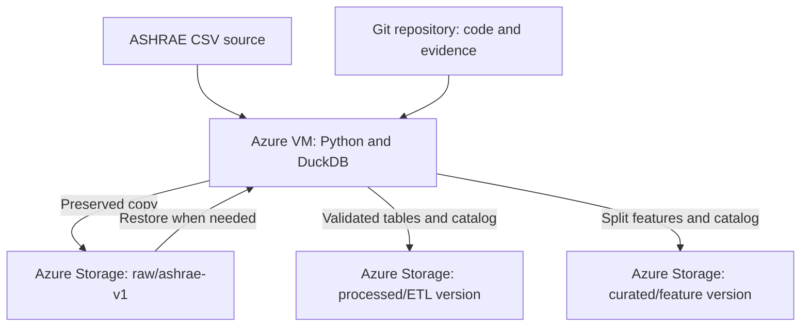

## Project and hypothesis

**Project:** One-hour-ahead building electricity consumption prediction.

**Team:** Saif al deen Judeh (60306539) and Adam Nashbat (60304819).

**Target:** The electricity meter reading at a building's next reported hourly timestamp,
standardized to kWh. **Baseline:** The same building's reading at the same hour one week
earlier (168 hours before the target). **Hypothesis:** A gradient-boosting model using
recent electricity readings, building characteristics, calendar information and recently
observed outdoor temperature will achieve at least 10% lower MAE than the weekly baseline
on chronologically later observations.

This Phase 1 submission implements the data foundation and initial features, not model
training or a test of the performance hypothesis. Temperature remains planned but is
not yet included: weather/meter timestamp alignment and forecast-time availability
need validation. The initial feature subset does not establish the full hypothesis.

Forecast origin is target timestamp minus one hour. The offline assumption is that a
reading is complete and available at its reported timestamp. Actual interval-label and
delivery-latency conventions must be confirmed before operational use. Evaluation is
planned as rolling one-hour-ahead prediction, allowing earlier observed validation/test
readings to become history for later forecasts without fitting on those labels.

## Dataset and architecture

Source: [ASHRAE Great Energy Predictor III](https://www.kaggle.com/competitions/ashrae-energy-prediction/data).
The dataset is different from the Titanic and Amazon lab datasets. The selected source
snapshot is `ashrae-v1`; CSV batch ingestion is run manually when a new version is approved.
Refreshes must use a new version and manifest; preserved versions are never overwritten.

The six extracted files total **2,610,923,746 bytes** (about 2.43 GiB). Excluding the
submission template, source data totals **2,163,361,235 bytes**, exceeding the approximately
1 GB requirement. All six files were ingested and fully profiled; no profiling sample
was used. The smaller supervised subset must not be described as the entire source.

| Raw file | Role | Rows |
|---|---|---:|
| train.csv | Observed meter readings across meter types | 20,216,100 |
| test.csv | Unlabeled competition prediction inputs | 41,697,600 |
| sample_submission.csv | Submission-format template, not observed labels | 41,697,600 |
| building_metadata.csv | Building/site/use/area and optional year/floor metadata | 1,449 |
| weather_train.csv | Training weather by site and reported timestamp | 139,773 |
| weather_test.csv | Competition test-period weather | 277,243 |

The project's validation and test partitions come from labeled `train.csv`, not from the
unlabeled competition `test.csv`. Electricity is meter code 0. Site 0 electricity is in
kBTU, confirmed by the [organizer's unit correction](https://www.kaggle.com/c/ashrae-energy-prediction/discussion/119261).
Only these readings are multiplied by 0.29307107; original readings/units remain available.

Azure resources: Ubuntu VM `vm-titanic-lab2`, 4 vCPUs and 16 GiB RAM, and storage account
`amazonlake60306539` (ADLS Gen2 enabled), in Qatar Central. The private container is
`electricity-project`. Azure CLI Blob APIs use the current Entra login. No managed feature
store, Purview service, new compute cluster or additional Azure service is created.



Processing reads verified local copies on the VM. Cloud publication verifies downloaded
bytes against SHA-256 and uploads the completion manifest last. Raw, processed and
curated versions have been published and verified, including safe reruns.

Storage layout:

- `raw/ashrae-v1/`: six original CSVs and source manifest.
- `processed/etl-v1-c4c56f89d676b969/`: electricity, metadata and weather Parquet; catalog and output manifest.
- `curated/features-v1-4416c69c061b464e/`: training/validation/test features; feature catalog and manifest.
- Local mirrors: `~/electricity-data/incoming/ashrae-v1`, `~/electricity-data/processed`, `~/electricity-data/features`.

Catalog JSON files record columns, types, keys and policies. Hash manifests connect
raw identity to processed outputs and feature outputs. They are an equivalent metadata
catalog/lineage structure; no Unity Catalog registration is claimed. Detailed policies:
[ETL rules](docs/etl_rules.md), [processed publication](docs/processed_publication.md),
[features](docs/features_v1.md) and [pipeline operation](docs/pipeline_operation.md).

## Run the pipeline

Prerequisites: Linux VM, Python 3.12, Git, Azure CLI with an active login to the course
subscription, and blob read/write permissions on the existing private container. Use
the submitted code checkout, preserved manifests and pinned configuration together.
Do not edit old code/config and expect an old version's identity checks to pass.

Clone the submitted repository to `~/electricity-project`. For a fresh environment:

```bash
cd ~/electricity-project
python3 -m venv .venv
.venv/bin/python -m pip install -r requirements.txt
az account show --query '{Subscription:name,State:state}' --output table
```

If Azure authentication has expired, sign in with your own authorized account and
select the course subscription. Access is controlled by Azure permissions, not by
making the container public. Dataset terms remain those of the source competition.

The six CSVs must exist at `~/electricity-data/incoming/ashrae-v1`. The team transferred
the original download there from Windows. An authorized reviewer can instead restore
the exact preserved version from Azure (downloads only files not already present):

```bash
mkdir -p ~/electricity-data/incoming/ashrae-v1
for name in building_metadata.csv sample_submission.csv test.csv train.csv weather_test.csv weather_train.csv
do
  target="$HOME/electricity-data/incoming/ashrae-v1/$name"
  if [ ! -e "$target" ]; then
    az storage blob download --account-name amazonlake60306539 \
      --container-name electricity-project --name "raw/ashrae-v1/$name" \
      --file "$target" --auth-mode login --no-progress
  fi
done
```

The pipeline verifies all source sizes/hashes before using them. Run:

```bash
cd ~/electricity-project
.venv/bin/python scripts/run_pipeline.py
```

The default run executes five test suites and eight data stages, with a console log
and linked evidence for each stage. A failure stops subsequent stages. ETL and feature
directories are obtained from the just-completed stage reports, not guessed from a
directory listing. Full profiling is repeated; data publication reuses verified assets.

After this exact code passes, demonstrate the full data-stage rerun without repeating
the unchanged synthetic test suites:

```bash
.venv/bin/python scripts/run_pipeline.py --skip-tests
```

Both commands were executed successfully on the Azure VM: the full run passed all
13 stages, and the data-stage rerun passed all 8 stages. The five synthetic test suites
passed 40 checks in total. The runner tests intentionally print failed child stages;
the suite passes only when those expected failures are correctly detected. Individual
commands remain in the linked technical documents. Dependencies: `duckdb==1.4.3` plus
Python standard library.

## Results and features

Verified results from the team's Azure VM:

- Raw ingestion: uploaded 7 objects; rerun uploaded 0 and skipped 7.
- Full profiling: all six files scanned; no duplicate natural keys. Metadata covered all training rows.
- ETL: 20,216,100 input training rows = 12,060,910 accepted electricity rows + 8,155,190 excluded non-electricity rows + 0 rejected rows.
- Metadata: 1,449 accepted; weather: 139,773 accepted. Missing optional values remain NULL.
- ETL tests: 9 passed, including controlled invalid input blocking publication and safe reruns.
- Processed Azure publication: uploaded 5; rerun uploaded 0 and skipped 5, with downloaded SHA-256 verification.
- Feature tests: 9 passed, including exact offsets, gaps, split boundaries, no current/future label influence on predictors and safe reruns.
- Feature build and rerun passed, preserving all electricity targets.
- Feature Azure publication: uploaded 5; rerun uploaded 0 and skipped 5, with downloaded SHA-256 verification.
- Full pipeline: 13 stages passed. Data-stage rerun: 8 stages passed. All 40 synthetic checks passed.

| Target partition | Period in 2016 | Rows | Weekly-baseline eligible |
|---|---|---:|---:|
| Training | January–August | 7,992,493 | 7,706,058 |
| Validation | September–October | 2,045,185 | 2,038,958 |
| Test | November–December | 2,023,232 | 1,989,186 |

Initial predictors are building/site IDs (categorical), use, area, hour, weekday, month,
weekend flag, exact 1/24/168-hour historical readings, missing-history indicators and
previous-hour-zero flag. Predictor allowlisting excludes target, partition, evaluation
mask and audit timestamps. Imputation/encoding/scaling have not been fitted. Any later
learned transforms must fit on training data only. Weekly-baseline MAE comparison must
use the same eligible rows for both models, with excluded counts reported separately.

Full training EDA is summarized in [EDA findings](docs/eda_findings_v1.md). Site 0 accounts
for about 73% of training zeros. There are 206,659 missing hours inside observed spans,
and one building is zero for all 5,856 training hours. These findings justify exact-time
joins and missing indicators and leave unresolved sensor/operational-quality risks.
Zeros and high values are not automatically deleted. Training target correlations with
1/24/168-hour lags are approximately 0.986/0.969/0.966. They are descriptive associations,
potentially influenced by building scale and zero runs, not forecast accuracy.

The combined pipeline also reproduces monthly/site distributions, quantiles, largest
readings, gaps, zero runs and building-area correlations in `evidence/eda_summary_*.json`.
Across 1,410 training-period buildings, the correlation between average electricity
and floor area was 0.593; the correlation between log1p average electricity and log area
was 0.767. These descriptive associations support exploring building area as a feature
but do not establish causation or predictive improvement. Pooled monthly changes must
be interpreted with reporting coverage and zero frequency. The 10% MAE hypothesis
has not yet been tested.

Supporting evidence:

- [source_manifest_v1.json](evidence/source_manifest_v1.json) and [raw_v1_etags.json](evidence/raw_v1_etags.json).
- [profile_20261113T140927Z-bfc742ba.json](evidence/profile_20261113T140927Z-bfc742ba.json).
- [etl_20261113T143147Z-607da4c3.json](evidence/etl_20261113T143147Z-607da4c3.json) and [etl_20261113T143316Z-2c9048b7.json](evidence/etl_20261113T143316Z-2c9048b7.json).
- [publish_processed_20261113T145235Z-211502ea.json](evidence/publish_processed_20261113T145235Z-211502ea.json) and [publish_processed_20261113T145417Z-814dd8ce.json](evidence/publish_processed_20261113T145417Z-814dd8ce.json).
- [time_quality_20261113T150254Z-67d35722.json](evidence/time_quality_20261113T150254Z-67d35722.json) and [lag_coverage_20261113T150505Z-d605a606.json](evidence/lag_coverage_20261113T150505Z-d605a606.json).
- [features_20261113T151352Z-949f841d.json](evidence/features_20261113T151352Z-949f841d.json) and [features_20261113T151534Z-c8eb3fa1.json](evidence/features_20261113T151534Z-c8eb3fa1.json).
- [feature_test_20261113T151649Z-68ea20c1.json](evidence/feature_test_20261113T151649Z-68ea20c1.json).

- [Full pipeline: 13 stages passed](evidence/pipeline_20261113T152643Z-170f7d7e.json).
- [Complete data-stage rerun: 8 stages passed](evidence/pipeline_20261113T153130Z-77298e09.json).
- [First feature publication](evidence/publish_features_20261113T152936Z-0a742360.json) and [verified publication rerun](evidence/publish_features_20261113T153419Z-c73f97b5.json).
- [Reproducible training EDA](evidence/eda_summary_20261113T152931Z-f4314577.json) and [EDA rerun](evidence/eda_summary_20261113T153413Z-d1018501.json).

Implementation checkpoint `ffe9eb0` records the completed pipeline and its Azure
verification evidence. Documentation is finalized in a subsequent commit. For course
submission, provide this repository's URL and the exact final commit or release in
D2L, and grant the instructor access. The applicable due date is shown in D2L.

## Resource use and contributions

| Observed job | Duration | Peak process RSS | Output size |
|---|---:|---:|---:|
| Full six-file profile | 103.06 s | 4,793.0 MiB | JSON report |
| Electricity ETL | 52.881 s | 1,543.76 MiB | 63.25 MiB |
| Feature build | 25.047 s | 2,440.82 MiB | 142.67 MiB |

Output sizes include data and catalog, excluding their final manifest. Remaining VM
disk space after the feature build was approximately 20 GiB. Measurements are reported
by the scripts on this VM; they are not estimated Azure billing charges.

We reused the existing 4-vCPU/16-GiB VM and storage account, limited DuckDB to two
threads and a 6 GB database memory budget, and used disk-backed temporary work plus
ZSTD Parquet. Actual ETL and feature peaks were within VM capacity. This supports the
resource choice without claiming free execution or a precise cost saving. Source-to-
output size differences include filtering/scope changes, not just compression. Full
download verification adds storage reads and transfer; safe reruns avoid data rewrites.

Cleanup: remove only disposable temporary/download files after verification. Keep raw,
processed, curated versions, manifests and evidence available through grading. When
finished working, deallocate the VM through Azure and confirm the deallocated state;
an idle/running VM still uses resources. Do not delete the shared storage account or
resource group, which also contain course lab resources. Disk/storage charges can
remain after compute deallocation; no exact price estimate is asserted.

Saif al deen Judeh (60306539) and Adam Nashbat (60304819) jointly carried out the
project work documented here. Their shared contribution covered selecting the task
and hypothesis, preparing the Azure environment and dataset, implementing the pipeline
with AI assistance, executing and reviewing tests, investigating data quality, designing
initial features, verifying Azure publications and reruns, and preparing documentation.
The work was performed through the shared project environment; commits made under
Saif's configured Git identity record the team's shared work.

| Team member | Contribution |
|---|---|
| Saif al deen Judeh — 60306539 | Joint contribution across the pipeline, validation, EDA, features and documentation described above. |
| Adam Nashbat — 60304819 | Joint contribution across the pipeline, validation, EDA, features and documentation described above. |

The implementation uses approaches practiced in the course labs. No direct reuse of
lab source files has been identified in this workflow; the project scripts were generated
with ChatGPT assistance and developed against the electricity dataset. Dataset and unit
references are linked above; the tool's role and resulting changes are documented below.

## Model and evaluation

### Validation results

We compared CatBoost with a baseline that predicts each building’s electricity
use from its value at the same hour one week earlier. Both methods were scored
on the same September–October readings.

| Validation group | Readings | Weekly baseline MAE (kWh) | CatBoost MAE (kWh) | Error reduction |
|---|---:|---:|---:|---:|
| All sites | 2,038,958 | 21.690 | 11.027 | 49.16% |
| Site 7 | 17,568 | 210.793 | 152.465 | 27.67% |

CatBoost reduced average error at all 16 sites. Site 7 still had the highest
average error, even after the improvement. The percentage reduction ranged from
27.57% (Site 2) 70.23% (Site 8).

[Full comparison for all 16 sites](evidence/phase2_validation_comparison.txt)

## AI use

Tool: ChatGPT, including code-generation and local testing tools. Requests covered
dataset/hypothesis formulation, Azure command guidance, manifest-backed ingestion,
profiling, ETL/quality gates, versioned publication, EDA, initial features and documentation.
Responses included Python scripts, configuration, Bash/PowerShell commands, tests and
draft explanations. The team executed commands on the real Azure VM and reviewed
the supplied outputs, which informed subsequent changes. Local assistant tests used
synthetic data; the Azure VM reports establish the full-data and cloud outcomes.

Changes made through this workflow included preserving source versions, explicitly
correcting site 0 units, keeping optional missing data as NULL, replacing row-offset
history with exact-time joins, adding quality-failure and tamper tests, adopting temporal
splits, excluding target-derived flags from predictors and deferring unaligned weather.
The team validated the generated implementation by running the full-data pipeline,
controlled failure tests, publication checks and safe reruns. AI-generated suggestions
are not treated as experimental results; the reported outcomes come from the retained
VM evidence. No model-performance claim is made in this phase.

(Adam) AI use: I recieved AI help with the initial connection to github and I recieved help with the comparison and the analysis wording in the README file. 
